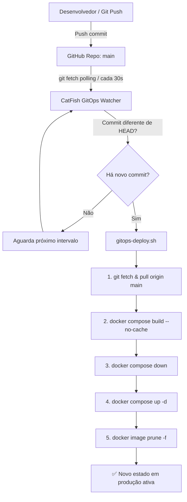

# 🔄 CatFish - Arquitetura e Guia GitOps Local

Este documento descreve como funciona a automação GitOps no repositório **CatFish** para manter a máquina local automaticamente sincronizada com o GitHub.

A cada novo `commit` enviado para a branch `main` no GitHub, o ambiente local detecta a mudança, atualiza o código, reconstrói as imagens Docker sem cache, reinicia os containers e remove imagens órfãs/antigas.

---

## 🏗️ Como Funciona o Ciclo

O fluxo automatizado segue o princípio GitOps onde o repositório Git é a **única fonte da verdade** (*single source of truth*):



### ⚡ Destaque: Construção Segura e Resiliente
O script realiza o `docker compose build --no-cache` **antes** de derrubar os containers anteriores (`docker compose down`). Isso garante:
1. **Downtime mínimo:** O serviço só é pausado pelos 2 a 3 segundos necessários para recriar os containers com a imagem nova já compilada.
2. **Proteção contra builds quebrados:** Se um commit trouxer um erro de compilação (ex: TypeScript ou falha de dependência npm), o build falha antes de derrubar os containers atuais, mantendo o sistema em funcionamento sem interrupções.

---

## 🚀 Instalação Rápida (Systemd User Service)

O serviço roda em segundo plano sob o gerenciador nativo `systemd --user` do Linux, sem requerer privilégios de `sudo`.

### 1. Ativar o serviço GitOps
Execute a partir da raiz do repositório:
```bash
./scripts/install-gitops-service.sh
```

Isso irá:
- Conceder permissão de execução aos scripts.
- Criar a unidade `catfish-gitops.service` em `~/.config/systemd/user/`.
- Iniciar e habilitar o monitoramento automático na inicialização do sistema.

### 2. Verificar o status e logs
```bash
# Ver status do serviço:
systemctl --user status catfish-gitops.service

# Acompanhar logs em tempo real:
journalctl --user -u catfish-gitops.service -f
```

---

## 🛠️ Comandos Manuais

### Executar o deploy manualmente a qualquer momento:
Se desejar rodar o ciclo uma vez sem esperar o watcher:
```bash
./scripts/gitops-deploy.sh
```

### Executar o watcher manualmente no terminal (foreground):
```bash
./scripts/gitops-watcher.sh
```

### Desinstalar / Desativar o serviço:
```bash
./scripts/uninstall-gitops-service.sh
```

---

## ⚙️ Variáveis de Configuração

Você pode customizar o comportamento definindo variáveis de ambiente antes da execução ou no arquivo de serviço:

| Variável | Padrão | Descrição |
| :--- | :--- | :--- |
| `GITOPS_INTERVAL` | `30` | Intervalo em segundos entre verificações no GitHub. |
| `GITOPS_BRANCH` | `main` | Nome da branch monitorada. |
| `GITOPS_REMOTE` | `origin` | Nome do remote Git monitorado. |
| `GITOPS_FORCE_RESET`| `0` | Se `1`, descarta qualquer alteração local não commitada via `git reset --hard origin/main`. |

---

## 💡 Manter o serviço ativo após Logout

Por padrão, serviços `systemd --user` são pausados se você deslogar do Linux (fechar a sessão da interface gráfica ou SSH). Para mantê-lo rodando de forma ininterrupta mesmo após fechar a sessão:
```bash
loginctl enable-linger $USER
```
